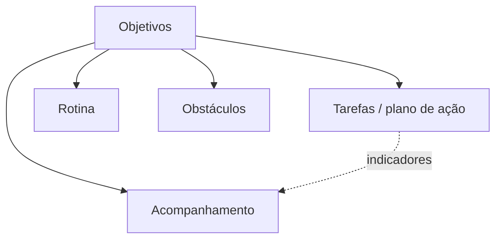
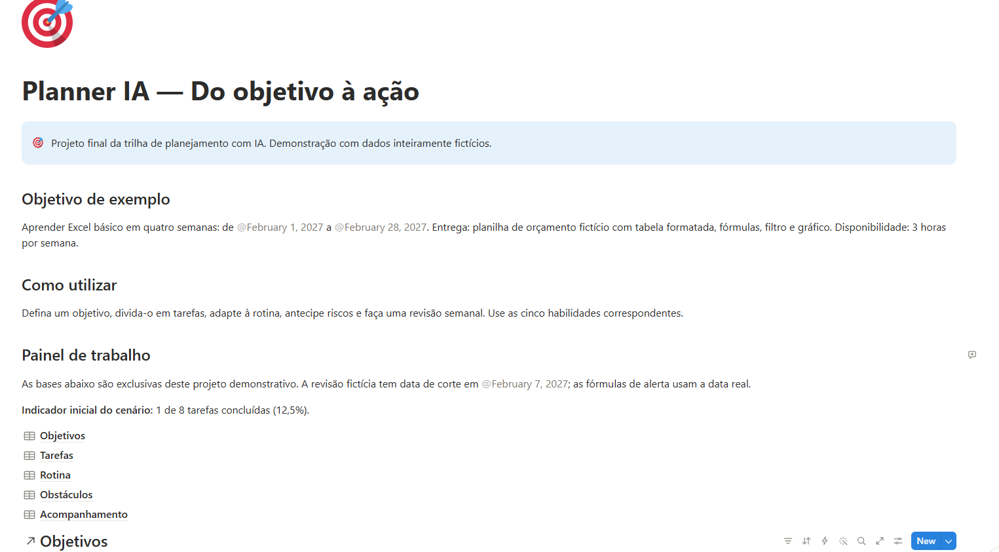

# Planner IA — do objetivo à ação

Assistente de planejamento reutilizável com Notion e ChatGPT | Projeto final da trilha de planejamento com IA.

## 1. Problema e proposta

Transformar uma intenção em um plano executável exige definir metas, escolher tarefas, encontrar tempo, lidar com imprevistos e acompanhar resultados. Quando essas informações ficam dispersas, é fácil perder prazos ou abandonar o plano. O Planner IA reúne essas etapas em um único método.

Seu diferencial é combinar um painel de bases relacionadas com cinco habilidades reutilizáveis. A IA entra na etapa adequada, com instruções específicas, sem exigir a repetição do método inteiro a cada conversa. O assistente respeita a disponibilidade, reserva tempo para imprevistos e propõe ajustes sem confundir atraso com fracasso.

## 2. Recursos e escolhas

| Ferramenta / recurso | Finalidade |
|---|---|
| Notion — bases de dados | Armazenar objetivos, tarefas, rotina, riscos e revisões de forma organizada. |
| Relações e rollups | Associar registros ao objetivo; a consolidação por rollup é uma melhoria proposta. |
| Visualizações vinculadas | Mostrar os mesmos dados em painel, tabela ou calendário, sem duplicar registros. |
| Fórmula de alerta | Sinalizar atrasos e prazos próximos com emojis coloridos; a cor condicional da visualização é opcional. |
| Habilidades do Notion Agent | Executar cada etapa usando instruções específicas, quando disponíveis. |
| ChatGPT | Elaborar as instruções, executar os cinco testes textuais e analisar o cenário fictício. Os arquivos SKILL.md permitem reutilização em ambientes compatíveis; em outros, podem ser usados como prompts. |
| Markdown e GitHub | Documentar o projeto e disponibilizar os arquivos para reprodução. |

**Estado desta versão:** o Planner foi implantado no Notion com cinco bases relacionadas, cinco visualizações vinculadas e cinco páginas de habilidades. Foram registrados 1 objetivo, 8 tarefas, 4 blocos de rotina, 4 obstáculos e 1 revisão. A demonstração abaixo registra testes textuais com ChatGPT e dados fictícios. A ativação e execução nativa das habilidades e os prints reais ainda precisam ser validados. O cálculo consolidado por rollup não foi implantado devido a um erro de configuração; o percentual histórico foi registrado na base Acompanhamento.

## 3. Estrutura do Planner

O painel possui quatro áreas obrigatórias: Plano de ação, Rotina, Obstáculos e Acompanhamento. A base Objetivos é o eixo que conecta todas elas.

| Base | Propriedades principais | Relação |
|---|---|---|
| Objetivos | Objetivo (título), Código (texto), Resultado esperado (texto), Indicador (texto), Meta (texto), Início e Prazo (data), Status (seleção), Horas por semana (número) | Uma relação inversa para cada base abaixo |
| Tarefas | Tarefa (título), Código, Data planejada e Prazo (data), Duração (min) (número), Status (seleção), Prioridade (seleção), Critério de conclusão (texto), Alerta e Concluída (fórmula) | Objetivo (relação); Dependência (texto) |
| Rotina | Bloco (título), Dia (seleção), Horário (texto), Duração (min) (número), Tipo (seleção) | Objetivo (relação) |
| Obstáculos | Obstáculo (título), Probabilidade, Impacto e Status (seleção), Gatilho, Prevenção e Plano alternativo (texto) | Objetivo (relação) |
| Acompanhamento | Revisão (título), Data (data), Concluídas no total, Total de tarefas, Progresso (%) e Horas realizadas (número), Dificuldade e Ajuste (texto) | Objetivo (relação) |



### Visualizações

- **Plano de ação:** tabela vinculada filtrada por objetivo e ordenada por prazo; calendário e quadro são evoluções opcionais.
- **Rotina:** blocos por dia e tipo.
- **Obstáculos:** tabela de riscos ativos filtrada por objetivo.
- **Acompanhamento:** revisões por data decrescente e progresso histórico.

### Fórmulas e alertas

Na base Tarefas, foi criada a propriedade `Alerta` do tipo fórmula (abaixo, versão textual equivalente aos alertas com emojis usados no painel):

```notion
ifs(
  prop("Status") == "Concluída", "Concluída",
  empty(prop("Prazo")), "Sem prazo",
  dateBetween(dateStart(prop("Prazo")), today(), "days") < 0, "Atrasada",
  dateBetween(dateStart(prop("Prazo")), today(), "days") <= 2, "Prazo próximo",
  "No prazo"
)
```

Use prazos sem horário. Na visualização compatível com cor condicional, associe vermelho a Atrasada, amarelo a Prazo próximo, verde a Concluída e deixe as demais neutras. Caso a opção não esteja disponível, exiba o texto do alerta. As cores não alteram o status da tarefa.

Também foi criada em Tarefas a fórmula `Concluída`:

```notion
if(prop("Status") == "Concluída", 1, 0)
```

Como evolução ainda não implantada, na base Objetivos, configure `Total de tarefas` como rollup da relação Tarefas (contar todos) e `Tarefas concluídas` como rollup da propriedade Concluída (somar). Crie a fórmula `Progresso`, exibida como porcentagem:

```notion
if(prop("Total de tarefas") == 0, 0, prop("Tarefas concluídas") / prop("Total de tarefas"))
```

O acompanhamento histórico guarda o retrato da data de revisão, enquanto o rollup acompanha o estado atual. A fórmula de alerta usa a data real do Notion; as respostas de teste usam a data fictícia explicitada.

## 4. Habilidades e instruções aplicadas

As instruções completas estão nos cinco arquivos abaixo. Todas seguem o mesmo padrão: quando usar, entradas, etapas, formato da resposta, restrições e confirmação antes de escrever nas bases. No Notion, as cinco páginas de habilidades foram criadas com referências às bases reais por menções.

| Habilidade | O que faz | Instrução principal |
|---|---|---|
| [Esclarecer objetivo](habilidades/01-esclarecer-objetivo/SKILL.md) | Transforma intenção em meta verificável | Definir resultado, indicador, prazo e restrições. |
| [Criar plano de ação](habilidades/02-plano-de-acao/SKILL.md) | Decompõe a meta | Gerar tarefas com prioridade, dependência, duração e critério de conclusão. |
| [Adaptar à rotina](habilidades/03-adaptar-rotina/SKILL.md) | Encaixa tarefas no tempo disponível | Respeitar limites, reservar revisão e contingência. |
| [Antecipar obstáculos](habilidades/04-antecipar-obstaculos/SKILL.md) | Prepara alternativas | Identificar gatilhos, impacto, prevenção e plano B. |
| [Revisar progresso](habilidades/05-revisar-progresso/SKILL.md) | Acompanha resultados e ajusta o plano | Calcular progresso, verificar atrasos e propor próximos passos. |

## 5. Demonstração prática

**Cenário fictício:** uma pessoa iniciante quer aprender Excel básico em quatro semanas, entre 01 e 28/02/2027. Pode dedicar até 3 horas semanais. O resultado esperado é uma planilha de orçamento com dados inventados, sem informações financeiras reais.

### Teste 1 — Esclarecer objetivo

**Entrada:** “Quero aprender Excel básico em quatro semanas, com até 3 horas por semana, para organizar um orçamento fictício.”

**Resposta da IA:** Objetivo: aprender Excel básico até 28/02/2027. Indicador: 8 tarefas concluídas e 4 critérios do projeto atendidos. Entrega: uma planilha com tabela formatada, fórmulas SOMA e MÉDIA conferidas, filtro funcional e gráfico coerente. Início: 01/02/2027. Status: em andamento no cenário de acompanhamento. Disponibilidade: 3 horas semanais. A meta é de aprendizado introdutório, não de domínio avançado.

**Verificação:** resultado, prazo, indicador, critério de sucesso e limite de tempo definidos.

### Teste 2 — Criar plano de ação

**Entrada:** “Transforme o objetivo em tarefas progressivas, respeitando o tempo disponível.”

**Resposta da IA:**

| Semana | Tarefa | Prazo | Minutos | Critério de conclusão |
|---|---|---|---:|---|
| 1 | T01 — Interface e formatação | 01/02 | 60 | Tabela formatada |
| 1 | T02 — SOMA e MÉDIA | 07/02 | 60 | 5 exercícios conferidos |
| 2 | T03 — Referências e porcentagens | 08/02 | 60 | Percentuais corretos |
| 2 | T04 — Organização e filtros | 14/02 | 60 | Filtrar e ordenar 12 registros |
| 3 | T05 — Gráficos | 15/02 | 60 | Gráfico por categoria |
| 3 | T06 — Orçamento | 21/02 | 60 | Tabela de receitas e despesas |
| 4 | T07 — Integração dos recursos | 22/02 | 60 | Fórmulas, filtro e gráfico integrados |
| 4 | T08 — Validação final | 28/02 | 60 | Quatro critérios atendidos |

As tarefas seguem a ordem T01 a T08; as dependências e prioridades estão registradas no CSV. Estudo previsto: 8 horas. Com 2 horas de revisão e 2 horas de reserva, o total planejado é de 12 horas em quatro semanas.

**Verificação:** tarefas mensuráveis, sequenciais e compatíveis com a disponibilidade.

### Teste 3 — Adaptar à rotina

**Entrada:** “Tenho segunda e quarta das 19h às 20h, sábado das 10h às 10h30 e domingo das 10h às 10h30.”

**Resposta da IA:** segunda: primeira tarefa da semana (60 min); quarta: segunda tarefa (60 min); sábado: revisão (30 min); domingo: reserva para recuperar atrasos (30 min). Carga máxima: 180 min. Se não houver atraso, o domingo fica livre. O prazo de algumas tarefas é posterior ao bloco planejado para preservar margem.

**Verificação:** a rotina cabe nas 3 horas disponíveis e separa estudo, revisão e contingência.

### Teste 4 — Antecipar obstáculos

**Entrada:** “Quais obstáculos podem impedir a execução e o que fazer?”

**Resposta da IA:**

| Risco | Prob. / impacto | Gatilho | Prevenção | Plano B |
|---|---|---|---|---|
| Imprevisto de agenda | Alta / alto | Bloco perdido | Manter reserva | Dividir tarefa em dois blocos de 30 min; replanejar se necessário |
| Dificuldade com fórmulas | Média / alto | 3 exercícios errados | Exemplos simples | Rever exemplo e refazer exercícios |
| Falta de acesso ao Excel | Baixa / médio | Aplicativo indisponível | Arquivo local | Usar Excel web ou Calc, conferindo compatibilidade |
| Cansaço | Média / médio | Atenção insuficiente | Pausas e metas pequenas | Fazer 30 min essenciais e reagendar restante |

**Verificação:** cada risco tem gatilho, prevenção e alternativa; nenhum risco é tratado como fato ocorrido.

### Teste 5 — Revisar progresso

**Entrada:** “Ao fim de 07/02/2027, concluí apenas T01, estudei 1 hora e perdi o bloco de quarta por imprevisto. Não recuperei T02 no domingo. Revise o plano.”

**Resposta da IA:** 1 de 8 tarefas concluídas = 12,5% do plano. A semana previa 2 horas de estudo, mas 1 hora foi realizada. T02 está pendente e vence em 07/02; ficará atrasada a partir de 08/02 se não for concluída. Para a semana seguinte: (1) segunda, usar 60 min para concluir T02, divididos em dois blocos de 30 min; (2) quarta, executar T03 após T02; (3) sábado manter revisão e domingo usar reserva para iniciar T04 por 30 min, reagendando sua conclusão para 15/02 se preciso. T05 e as próximas tarefas devem ser reavaliadas após a recuperação; não ultrapassar 180 min na semana. Não alterar status de tarefas sem confirmação.

**Verificação:** percentual correto, atraso interpretado pela data de corte e replanejamento com capacidade limitada. Não se declarou que o objetivo foi concluído.

## 6. Ajustes incorporados às instruções

Durante a elaboração e a checagem textual, foram incluídas regras para distinguir data planejada de prazo, preservar uma reserva, não inventar registros concluídos e impedir o cálculo de progresso com denominador zero. O teste de revisão evidencia que um atraso pode exigir deslocar tarefas dependentes, em vez de simplesmente aumentar a carga semanal.

## 7. Como reproduzir

Veja o [guia de instalação e publicação](GUIA.md). As cinco bases preenchidas estão em [bases](bases/), o painel de exemplo em [notion/Planner.md](notion/Planner.md) e as instruções reutilizáveis em [habilidades](habilidades/).

## 8. Evidências e próximos passos

Os cinco testes acima são respostas textuais produzidas com dados fictícios. O Planner já está implementado no Notion. Para finalizar as evidências do portfólio, executar as habilidades nativas e acrescentar prints reais do painel e de pelo menos uma execução. Não incluir informações pessoais nem publicar o endereço privado do workspace.

Possíveis evoluções: revisão semanal agendada, integração com Google Agenda e conexão entre Notion e ChatGPT, após autorização e validação.

## Referências

- [Notion — importação de dados](https://www.notion.com/help/import-data-into-notion)
- [Notion — relações e rollups](https://www.notion.com/help/relations-and-rollups)
- [Notion — habilidades do agente](https://www.notion.com/help/create-and-manage-skills)
- [OpenAI — habilidades no ChatGPT](https://help.openai.com/pt-br/articles/20001066-skills-in-chatgpt)
## 9. Evidências dos testes no Notion

As cinco etapas foram demonstradas com dados fictícios. As habilidades 02, 04 e 05 tiveram acionamento explicitamente confirmado pela IA; as etapas 01 e 03 produziram respostas adequadas.

### Painel do Planner


### Teste 1 — Esclarecer objetivo


### Teste 2 — Plano de ação


### Teste 3 — Rotina


### Teste 4 — Obstáculos


### Teste 5 — Progresso

